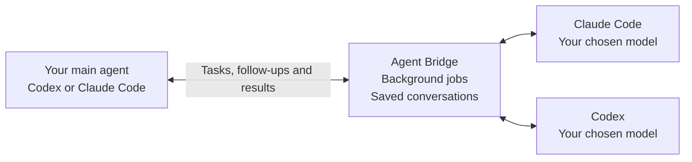

# Agent Bridge

Persistent local delegation between Claude Code and Codex, available to MCP clients. Start a review or isolated implementation task, keep working, then inspect progress and continue the same native conversation.

Public preview.

## How it works

Codex can ask Claude to review its work. Claude can ask Codex to implement a change. Agent Bridge connects them and keeps the delegated conversations available.



- **Delegate:** choose Claude Code or Codex, then the model, effort level and permissions.
- **Keep working:** your main agent stays available while the other agent works. It checks progress, handles questions or requested approvals, and retrieves results.
- **Keep context:** continue the same conversation or fork it to try another approach. Write tasks use separate Git worktrees.

The bridge runs on your computer using your existing CLI installations and accounts.

## Setup

### Set up with your agent

Paste this into **Codex or Claude Code running on your computer**:

```text
Install and set up Agent Bridge for me:
https://github.com/mafazsyed/agent-bridge

Read docs/setup.md in that repository and carry out the setup. Detect my OS
and installed Codex / Claude Code CLIs, build Agent Bridge in a permanent
folder, register its MCP server in the installed clients, and install the
matching delegation skills. Reuse a working installation if one already exists.

Preserve my existing settings and permissions. If a prerequisite or agent CLI
is missing, give me its official installation instructions instead of installing
it automatically. Let me handle any sign-in. Verify the setup, then tell me
which delegation directions are ready and whether I need to restart anything.
```

The agent handles installation and configuration; you handle any required sign-in or client approval. Both CLIs are needed for delegation between Codex and Claude Code. [Setup guide](docs/setup.md) · [Manual setup](#manual-setup)

### Manual setup

Requirements: **Node 24+**, Git for implementation tasks, and the installed native executable for the runtime you want to delegate to (Claude Code, Codex, or both). Authenticate through the runtime itself: `claude auth login` or `codex login`. Agent Bridge does not collect credentials or provide a separate sign-in service.

Use a current native Codex CLI (this adapter is tested with **0.163.0**) for Codex delegation. Keep its bundled execution helpers beside the executable; do not copy only the main binary. Older or incompatible protocol/configuration responses fail without dispatching a prompt.

Use a current Claude Code version. The default Opus 5.5 model requires Claude Code 2.1.280 or newer; an older executable can authenticate successfully but still be refused when it calls that model. Run `claude update` if the runtime reports that it is too old.

On Windows, install the native `claude.exe`; npm `.cmd` wrappers are not executed through a shell. Saved jobs can be inspected and cancelled even if Claude has been removed. Starting new jobs requires the executable.

```sh
git clone https://github.com/mafazsyed/agent-bridge.git
cd agent-bridge
npm ci
npm run build
node dist/cli.js doctor
```

Configure a local stdio MCP server in your client:

```json
{
  "mcpServers": {
    "agent-bridge": {
      "command": "node",
      "args": ["/absolute/path/to/agent-bridge/dist/cli.js", "mcp"]
    }
  }
}
```

For Codex CLI, the equivalent is `codex mcp add agent-bridge -- node /absolute/path/to/agent-bridge/dist/cli.js mcp`. Paths containing spaces must be quoted in your shell. The repository also includes a portable `plugin.json`, `mcp.json` and a `skills/claude-delegation` skill. Build the checkout before registering it as a local plugin; Git alone does not supply `dist` or dependencies. No lifecycle hooks or automatic configuration edits are required.

### Codex tool approval

Registration and trust are separate. If Codex reports `MCP tool call requires approval, but approval policy is never`, the server connected, but that profile cannot approve the call. Choose interactive approval, or explicitly trust this server in Codex's configuration:

```toml
[mcp_servers.agent-bridge]
# Keep the existing command, args and env configuration.
default_tools_approval_mode = "approve"
```

Only enable that setting when you want Codex to call all of this server's tools, including `answer_permission`, under your task instructions. With default permissions a delegated Claude Bash command still stops at the bridge's one-time approval; this setting lets Codex supply that approval when your authorization covers it. It does not make the worktree a sandbox. The delegation skill explains the workflow. See [Codex MCP configuration](https://developers.openai.com/codex/mcp/) for per-tool alternatives.

## Use

Ask your MCP-enabled agent to delegate a review to Opus. It can use:

| Tool | Purpose |
| --- | --- |
| `list_models` | Read the selected runtime's live model catalogue and effort capabilities |
| `list_permission_modes` | Discover native permission controls without submitting a prompt |
| `get_account_limits` | Read current native account quota windows without inference |
| `start_run` | Start a job or queue a follow-up on a conversation |
| `fork_conversation` | Branch an idle conversation into independent native history and send its first prompt |
| `get_run` | Read status, results, pending input and raw event pages |
| `get_progress` | Concise progress, stop reason, exit evidence and handoff readiness |
| `get_transcript` | Page through normalized activity without repeated native frames |
| `capture_checkpoint` | Save a read-only Git snapshot: branch, commit and dirty files |
| `record_handoff` | Save a host-reported summary, checks and unfinished work |
| `wait_run` | Wait up to 50 seconds for changes |
| `cancel_run` | Request cancellation; poll until terminal |
| `answer_permission` | Approve or deny one command, or answer a question |
| `list_runs` | Find recent jobs without calling a runtime |
| `list_conversations` | Find reusable sessions and workspaces |

Example `start_run` input:

```json
{
  "requestKey": "auth-review-1",
  "cwd": "/path/to/project",
  "prompt": "Review the authentication change and report actionable findings with file references.",
  "model": "claude-opus-5-5",
  "effort": "high"
}
```

The default is review mode, Opus 5.5 and high effort. The account must have access to the requested model. The bridge does not configure automatic fallback; Claude Code resolves aliases and applies its own account policies. The runtime's reported model and requested effort are recorded in the run's `started` event. When Claude reports the applied effort, `effortReported` is true and `effortApplied` contains its value (or null if no effort parameter applies). Otherwise `effortReported` is false: the applied effort is unknown, not necessarily the requested value. Each new turn gets a new request key. Repeating the exact input with the same key returns the original job rather than dispatching it again. Follow-ups pass `conversationId` instead of `cwd`; their model and effort can be overridden per turn.

Opus is not required. Ask Codex to call `list_models`, or run `node dist/cli.js models`. The bridge queries the installed Claude Code runtime through the official Agent SDK's `supportedModels()`, without submitting a prompt, creating a saved run or using a model-task slot. Discovery can make network requests through Claude; it is not an offline entitlement check. It has a 20-second deadline. Overlapping calls within one MCP server share a probe; completed results are not cached.

Each entry preserves Claude's `value` alias, `resolvedModel` when supplied, display name, description and reported effort support. Use `value` to follow Claude's alias selection or the resolved ID to request that version explicitly. Choose effort from `supportedEffortLevels`; null capability fields mean unknown, while `supportsEffort: false` means the runtime reports no effort support. The bridge's default remains high; Claude can ignore or cap effort according to the model and account policy. Account details from initialization are not returned. The catalogue is picker metadata, not a guarantee of entitlement or remaining quota; a missing model is not automatically rejected by the bridge. Refresh after changing account or runtime. The MCP catalogue uses the same executable and settings boundary as its delegated runs; a separately configured CLI can see a different catalogue. See [Claude model configuration](https://code.claude.com/docs/en/model-config).

For implementation, add `"mode": "write", "baseRef": "HEAD"` to a **new** conversation. The bridge creates a branch and worktree from that commit. It leaves the original checkout, including uncommitted changes, alone. The result includes the worktree path. Review and integrate that diff deliberately; the bridge does not automatically commit, merge or push.

You can use the CLI independently: pipe the same JSON into `node dist/cli.js start`, then use `get RUN_ID`, `wait RUN_ID`, `cancel RUN_ID`, `runs` and `conversations`. `answer PERMISSION_ID` reads `{ "decision": "allow" | "deny", "answers": { "question": "answer" } }` from stdin. Only supply `answers` for a question.

For incremental progress, use `get RUN_ID CURSOR` and `wait RUN_ID SECONDS CURSOR`, passing the previous `nextCursor`. Cursor zero retrieves existing progress immediately.

## Claude Code → Codex

Register the same server in Claude Code:

```sh
claude mcp add --scope user agent-bridge -- node "/absolute/path/to/agent-bridge/dist/cli.js" mcp
node dist/cli.js doctor codex
node dist/cli.js models codex
```

Copy `skills/codex-delegation` into your Claude skills directory if you want its workflow instructions. Restart the host after registering or upgrading the server. The first upgraded process migrates the ledger to schema 3; older binaries refuse that newer ledger. Keep a backup before downgrading.

Ask Claude to call `list_models({"runtime":"codex"})`, then `start_run` with `"runtime":"codex"`, `cwd`, `requestKey` and `prompt`. Omitted model and effort use Codex's configured defaults (or its native catalogue default); the first start saves the actual selection. Explicit choices must exist in Codex's current catalogue. No model ID or effort list is hard-coded. Follow-ups use `conversationId` and cannot switch runtimes. Per-run model/effort overrides do not change the saved conversation selection.

Codex uses the native `app-server` JSON-RPC protocol over private stdio, not a remote server or a copied credential. Model discovery sends no prompt and creates no thread. Jobs use a saved native thread; `nativeId` in the result is the ID for `codex resume <nativeId>`. A missing transcript is an error, never a silent fresh start. Codex does not expose Claude's `maxTurns` budget, so that argument is rejected for Codex; use `timeoutSeconds` instead.

**Default Codex permissions:** review requests native read-only with network disabled and refuses new escalation requests. Existing native execution rules can authorize commands outside that sandbox in **both review and write mode**. Reads are not confined to the workspace. Write uses the native workspace sandbox with network disabled and temporary-directory write exemptions removed. Sandboxed commands and edits run without per-command approval; native escalation requests stop for a one-time bridge decision. The bridge never grants session-wide approvals or saves execution rules. An approved escalation can affect resources outside the worktree. Codex does not have Claude's bridge file hooks: inspect changes to agent configuration before integrating a worktree; detected changes produce a warning.

On Windows, the adapter preserves the native sandbox implementation instead of downgrading it. Run from an interactive Windows logon: our native sandbox runner failed under SSH on the tested host, while the interactive session passed. On Ubuntu systems that restrict unprivileged user namespaces, the official Codex installation may need an administrator-managed AppArmor profile; the bridge does not disable host protections.

The adapter disables inherited MCP servers, apps, plugins, hooks and nested delegation, then verifies the effective sandbox and thread MCP status before sending the prompt. It fails if that boundary cannot be established. Native enterprise restrictions still apply. Existing native execution rules can authorize commands outside the sandbox without a new bridge approval; this adapter does not erase your rules. Treat that native configuration as part of the trusted setup. The bridge itself never adds rules or grants standing approvals. Cancellation interrupts the exact turn and closes the app-server process tree it owns, including on the worker’s emergency exit. Windows sandbox commands can run under a separate OS account; native cleanup of those processes depends on the Windows session and sandbox setup. Transport loss after dispatch is an uncertain outcome and is never automatically retried.

## Permissions

**Claude:** review mode exposes only Read, Glob, Grep and AskUserQuestion. Write mode adds Edit, Write and Bash. A pre-tool hook checks file/search paths, including symlinks; direct edits to Git metadata and agent configuration are denied. Project and user settings, external MCP servers and slash commands are not loaded by the bridge's runtime configuration.

With omitted/default Bridge permissions, every Claude Bash command requires a one-time host decision. The pending request contains its exact input. Approval must come from the human's existing authorization or a new human decision, never from Claude's request itself. Do not approve arbitrary commands just to clear a blocked job.

**A worktree is not a sandbox.** An approved shell command can access outside it, use the network and run repository scripts. Git checkout can invoke configured filters in the explicitly selected trusted repository. Tool checks are not an OS security boundary against other local processes or filesystem races. Explicit native bypass/full-access selections remove ordinary approval or sandbox protections, as described below.

### Native permission selection

`mode` and `permissions` control different things:

| Control | Purpose |
| --- | --- |
| `mode: "review"` or `"write"` | Bridge workspace and tool boundary. Write creates an isolated Git worktree; this stays fixed for the conversation. |
| `permissions` | Runtime-native approval/sandbox selection for a run. Omitted inherits the conversation default; `null` selects the original Bridge-controlled policy. |

Call `list_permission_modes({"runtime":"claude"})` or `node dist/cli.js permissions claude` (use `codex` for Codex). Claude discovery tests its control API with no prompt and no tools. Codex discovery reads its generated protocol schema and administrative requirements. No account settings are changed; neither probe uses an inference turn. Unsupported/new protocol values are identified, not silently translated. Model entries also expose Claude's `supportsAutoMode` (`null` means unknown).

Claude accepts these explicit selections:

| `permissionMode` | Native behavior | Bridge workspaces |
| --- | --- | --- |
| `default` | Unresolved actions ask the host; edits are no longer pre-approved | review, write |
| `acceptEdits` | Automatically accept edits; other actions follow native checks | write |
| `plan` | Return a plan; Bridge supplies only review tools, so it cannot exit into editing itself | review, write |
| `dontAsk` | Deny unapproved actions without asking; this can deny edits and questions too | review, write |
| `auto` | Use Claude's own automatic permission classifier | write |
| `bypassPermissions` | Skip ordinary native permission checks | write |

The CLI may label `default` as **manual**; the SDK reports `default`. Explicit modes keep Bridge's tool ceiling, file/path checks, protected metadata, no background Bash and cancellation guards. Ordinary actions are deferred to Claude, without hook-based auto-approval or extra pre-approved edit rules. `auto` is subject to account/model/organization restrictions. The runtime must confirm the selected mode **before the prompt is sent**; it is checked again on initialization and tool calls. Incompatible older CLIs and silent downgrades are refused. A mode change after dispatch stops the turn with an uncertain outcome.

Native `default` does not mean every shell command asks: Claude may allow read-only commands, and `acceptEdits` may also allow filesystem commands. Shell commands are not confined by Bridge's direct-file path checks and can access outside the worktree when the native policy permits. Use omitted/null Bridge permissions if every Bash command must go through the host.

```json
{
  "requestKey": "implement-with-native-edits-1",
  "cwd": "/path/to/project",
  "mode": "write",
  "baseRef": "HEAD",
  "prompt": "Implement the agreed change and test it.",
  "permissions": { "runtime": "claude", "permissionMode": "acceptEdits" }
}
```

Codex requires three separate native fields:

```json
{
  "runtime": "codex",
  "sandbox": "workspace-write",
  "approvalPolicy": "on-request",
  "approvalsReviewer": "user"
}
```

Pass that object as `permissions`. Sandboxes are `read-only`, `workspace-write` and `danger-full-access`. Approval policies are the installed protocol's supported `untrusted`, `on-request`, `never`, or a `granular` object with all five booleans: `sandbox_approval`, `rules`, `skill_approval`, `request_permissions`, `mcp_elicitations`. A reviewer is `user` (forward native requests to the host) or `auto_review` (Codex's own automatic review). The deprecated `guardian_subagent` alias and arbitrary named permission profiles are not exposed as Bridge selections. Availability is checked against the applied native response before every prompt, including resumes. `untrusted` is retained only where the native runtime supports it; current documentation may recommend newer policies.

`never` means no approval prompts, **not** full access. Sandboxed selections keep network disabled and workspace-write excludes temporary roots. `danger-full-access` removes that sandbox, including its network boundary. Codex review workspaces accept only `read-only` / `never` / `user`; other combinations require a write worktree. Inherited native execution rules remain relevant, and external tools remain disabled. Flags for disabled tools in a granular policy do not enable those tools.

A new conversation saves its initial selection. Follow-ups can override `permissions` **for that run only**, just like model and effort; later omitted values return to the conversation default. This supports planning then editing in the same native session. Requests save their selection at submission, so queued jobs cannot change each other's settings. The run's `started` event reports the applied controls. Explicit `null` returns one run to the original Bridge policy.

Broad access is opt-in through the explicit selection. Host agents must have the human's authorization for that access; a worker or repository cannot grant it. There is no second confirmation checkbox. A worktree does not confine shell commands, and Claude bypass or Codex full access can affect resources outside it. User/organization restrictions can still refuse a selection. Permission discovery is not a guarantee of account quota or every model's capabilities.

## Parallel jobs, model changes and forks

Multiple conversations can use different runtimes, models, effort levels and permission selections. `AGENT_BRIDGE_MAX_ACTIVE` accepts any positive safe integer or `unlimited` (the default); there is no four-job ceiling. Additional jobs queue when a finite limit is reached. A job waiting for approval occupies a slot. Turns within one conversation remain serialized even with unlimited concurrency. Configure the same limit in every client sharing that state directory. After updating an existing installation, restart its MCP connections to load the new default; already-running workers keep their launch-time setting. Workers cannot recursively delegate through Bridge. Every queued job has a worker process, and every active job also starts a native runtime; choose concurrency to suit your machine and account quota. Queued polling backs off with jitter, and brief SQLite contention is retried within the lease window.

To change model or effort, submit the next `start_run` with the existing `conversationId` and the desired values from `list_models`. This preserves the native history and workspace. Overrides apply only to that run: an omitted value on a later turn returns to the saved conversation default. Bridge does not change models during a running turn. Switching between Claude and Codex requires a new conversation.

Use `fork_conversation` to try a different approach without changing the original conversation:

```json
{
  "sourceConversationId": "<saved Bridge conversation UUID>",
  "requestKey": "alternative-approach-1",
  "prompt": "Try the simpler approach we discussed."
}
```

The CLI equivalent is `node dist/cli.js fork`, reading the same JSON from stdin. The result has a new `conversation.id` and `run.id`; wait for that run, then continue it with `start_run({conversationId: ...})`. `list_conversations` and run responses expose its `fork` lineage and `sessionInitialized` state.

Forks use the same runtime and workspace mode. They inherit the source's **saved** model, effort and permission defaults, not a temporary override on its last run. Optional model/effort/permissions become the new fork's defaults; `permissions: null` explicitly selects Bridge's original policy. Parent settings stay unchanged. Bridge approval decisions are not copied.

The source must be idle, with its latest run successful. Resolve failed or uncertain work first. While a fork is queued or copying history, parent follow-ups return `fork_in_progress`; retry the unsaved request after the fork initializes. Multiple forks may copy the same source, and after initialization parent and forks can run independently. Do not use the source concurrently through its native CLI or edit its files during the snapshot: Bridge cannot lock outside clients.

| Source mode | Fork workspace |
| --- | --- |
| Review | Same directory, with the same review boundary; files are not frozen |
| Write | A new worktree at the source's HEAD, with its tracked and nonignored untracked working files copied as uncommitted edits |

A write snapshot uses a temporary Git index and a tree object. It does not commit, stash, reset or change the parent's index, branch or files, and needs no Git author/signing identity. Staged/unstaged distinctions are flattened in the child. Ignored files, including ignored dependency folders and environment files, are not copied. Repository filters can run and line endings follow Git configuration. Submodules, embedded repositories and agent-configuration changes since the source's original base are refused, including committed changes. For intentional configuration updates, review them and start a new conversation from the accepted base. The tree object remains in the shared Git object store until Git's normal cleanup; the fork's receipt records its identity. A worktree is not an OS security boundary: explicitly authorized broad native permissions or commands can still reach other directories.

Forks retain native conversation history, not just the last answer. Claude uses its [native session fork](https://code.claude.com/docs/en/agent-sdk/sessions); Codex uses [`thread/fork`](https://learn.chatgpt.com/docs/app-server#threads) with fresh identity and verified workspace/permission settings. No fallback to a fresh empty chat is attempted. Repeating the exact request key returns its original run. If initialization fails, inspect that result before submitting a new fork with a new key; an uninitialized fork cannot be resumed. A crash between native fork creation and recording its ID can leave an unused native transcript.

Claude can compact long copied history; Bridge records `fork_history_compacted` and checks that the saved child transcript is nonempty. Otherwise it checks the child message count against the source plus new messages, including when the turn fails. This is a persistence check, not proof that a compacted summary preserves every detail. Codex pins the source's last completed turn when its event is retained. After event pruning it copies the native thread's latest history instead; the `started` event exposes `forkTurnPinned: false`. Codex forks and child resumes refuse native goals set outside Bridge, including paused or completed goals: clear the goal in Codex first. This prevents additional automatic turns outside the Bridge job. Avoid using the source concurrently outside Bridge. Each runtime's own retention policy determines how long its transcript is available.

This edition forks the latest completed history. Active-turn forks, earlier-message selection, cross-runtime history conversion and changing workspace mode are not exposed. Cumulative usage in a native fork may include inherited history: never add or subtract parent/fork totals to infer new spend.

## Usage and account limits

`get_run`, `wait_run` and `list_runs` include `run.usage` when the native runtime reports it. This is passive accounting: it does not add model calls. Old runs and turns with no usage report have `null`; missing counters remain `null`, not zero. Usage survives restarts and content pruning. A snapshot marked `reported` means native telemetry arrived, not that the run succeeded; check the run status too.

| Runtime | Recorded values | Scope |
| --- | --- | --- |
| Claude | Input/output and cache tokens in `turn` | Current turn's main agent loop; excludes auxiliary calls |
| Claude | `cumulative.models` and `cumulative.estimatedCostUsd` | Native cumulative totals, including saved spend restored on resume; estimates, not bills |
| Codex | `cumulative.tokens`, `lastReported`, context window | Native thread total and native `last` snapshot; no fabricated per-turn total or cost |

Never sum cumulative snapshots across runs. Claude versions before 2.1.277 reported query totals instead of restoring saved session spend; `cumulative.scope` records that distinction when the runtime version is known. Error results with zeroed counters are marked unavailable. Interrupted Codex work keeps the latest partial snapshot. Token categories overlap: Codex cached input is included in input and reasoning in output, so do not add those categories to totals again. Claude cache input is separate from its regular input. We do not subtract snapshots to estimate one run's cost, because sessions can also be resumed outside Bridge or cleared.

Use `get_account_limits({"runtime":"claude"})` or `get_account_limits({"runtime":"codex"})` for a fresh account-wide quota snapshot. The CLI equivalent is `node dist/cli.js limits claude` (or `codex`). It returns utilization windows, reset times in ISO format, native availability/denial flags and supported credit-availability indicators. These include other activity on the account. They cannot be attributed to a Bridge run or converted to cost. Native denial flags take precedence; a percentage or reset time does not promise access.

The limits probe starts no inference, consumes no job slot, changes no conversation or settings and stores no account snapshot. Concurrent reads are coalesced; completed responses are not cached. Account identifiers, balances, spend amounts, reset-credit IDs, behavioral scans and raw runtime diagnostics are excluded. API-key accounts may have no plan limits. Unsupported APIs and unavailable limits are distinguished from authentication errors, timeouts and other failures. Claude's account probe uses an explicitly experimental SDK API and can become unavailable after an upstream change.

## Lifetimes and recovery

- A **conversation** retains its runtime, native session identity, workspace and mode. It survives completed jobs and can be resumed in that runtime's CLI. Codex's `nativeId` is distinct from the bridge conversation ID.
- A **run** is one submitted turn. Follow-ups queue in insertion order; only one turn runs per conversation.
- A detached **worker process** owns a run and updates its lease. Closing the MCP connection does not normally stop the worker. Independent conversations run concurrently by default; set `AGENT_BRIDGE_MAX_ACTIVE` to bound concurrency.
- `needs_input` means a real pending question or permission request. A five-minute deadline expires unanswered requests. Cancellation and expired answers cannot authorize later execution.
- `succeeded` means the runtime returned a successful terminal result. Verify its claims against files/tests; it is not an independent correctness verdict.
- A stale worker or stream that ends without a trustworthy result produces `unknown`. Nothing is automatically replayed. Inspect the saved conversation/worktree, then explicitly acknowledge uncertainty if continuing.

For a quick answer to “what happened, and can I continue?”, use `get_progress({"runId":"…"})` or `node dist/cli.js progress RUN_ID`. It returns a short result preview and recent activity, with event cursors pointing to the full evidence. `recovery` keeps **why the runtime stopped** separate from **whether cleanup and the saved session were confirmed**:

| Field | Meaning |
| --- | --- |
| `stopReason` | `completed`, `allowance_exhausted`, `throttled`, `capacity`, `turn_limit`, `budget_limit`, `cancelled`, `timeout`, `authentication`, `runtime_failure` or `uncertain` |
| `worker` / `runtime` | `running`, `exited`, `not_started` or `unverified`, based on the owned process and its start identity |
| `shutdown` / `transcript` | Whether shutdown completed and a terminal session result was reported; a process exit alone is insufficient |
| `readyForHandoff` | This run's owned processes have stopped and there are no other active runs in its Bridge conversation. An uncertain transcript still requires inspection |
| `readyForFollowUp` | The current evidence supports a deliberate follow-up now; this is not a correctness or side-effect guarantee |
| `nextAction` | `wait`, `inspect`, `retry_when_available` or `continue` |

For example, an exhausted allowance followed by a failed transcript flush remains `status: "unknown"` with `stopReason: "allowance_exhausted"` and `nextAction: "inspect"`. The cause is retained; Bridge never silently retries the prompt or bypasses the existing `acknowledgeUncertain` requirement. Account availability is not inferred from a run's error: use `get_account_limits` for current reported limits. A native success followed by failed cleanup is likewise not a clean continuation. Older receipts have no new process evidence and remain unverified; older `rate_limited` errors cannot reliably distinguish quota from throttling.

At worker completion, Bridge attempts a bounded, read-only Git checkpoint. `capture_checkpoint` can refresh it later. It contains the observed branch, HEAD, up to 200 dirty paths and a timestamp. Missing Git, timeout or capture failure is **unknown**, never a clean worktree. The snapshot can include changes from other work and does not lock the directory, freeze a revision or commit anything.

Use `record_handoff` (CLI: `handoff RUN_ID`, JSON on stdin) to preserve explicit unfinished work and check results:

```json
{
  "runId": "<run UUID>",
  "summary": "Parser change is ready; the integration failure still needs investigation.",
  "unfinishedWork": ["Investigate the integration failure"],
  "checks": [{"description":"npm test", "result":"failed", "evidenceSeq":42}]
}
```

The whole handoff is labelled `host_reported`. An optional evidence sequence must belong to that run. Agent text is a claim, tool activity is an observation, and even a recorded command exit code does not prove the task is correct. Claude command completions without an explicit exit code retain `null`; Bridge does not guess a passing test from prose. Arbitrary command output is not added to these summaries. Checkpoint and handoff content is removed by `prune`.

`get_transcript` / `transcript RUN_ID [CURSOR]` returns chronological, bounded activity pages. Exact repeats with the same native identity and content are suppressed; distinct equal messages remain separate. Later versions of a message retain `messageKey`, so a streaming reader can replace its earlier presentation. `get_run` retains the stored raw revisions. This is Bridge's captured activity, not a full reconstruction of native session history; missing or pruned content is not recreated.

Process evidence is a point-in-time observation of Bridge's worker and native runtime, not a lock on external clients or proof that every command's external side effect has stopped. Inspect uncertain outcomes before taking over; avoid running the same native session outside Bridge concurrently.

A stale heartbeat is checked against the worker's PID and start identity before fencing it, so sleep does not by itself invalidate a living worker. Inconclusive process probes defer reconciliation; workers must establish their own start identity before launching a runtime. Run deadlines still include time asleep. An abort that does not settle within 60 seconds is recorded as an uncertain outcome, then the worker exits. If the host died before launching a worker, reconciliation marks the unstarted job `failed/worker_start_lost` after two minutes. Repeating the original key returns that failure; submit a **new** key to retry this known unstarted job. Cancellation of an unstarted job is immediate.

To use native Claude continuation, change into the saved conversation's `cwd` and run `claude --resume CONVERSATION_ID`. Do not operate the same session concurrently through both interfaces. If Claude's transcript is missing after a crash, start a new conversation deliberately; the bridge does not silently replace its identity. An incomplete worktree checkout is similarly refused without resetting any user edits. Startup diagnostics, when the ledger cannot be opened, go to private `worker-errors.log`.

There is no exactly-once execution guarantee, no promise that work survives a machine reboot, and no automatic wake-up of an idle Codex chat. A command already executed before cancellation is not undone. Native transcripts remain under each runtime's own management.

## Configuration and storage

| Environment variable | Default |
| --- | --- |
| `AGENT_BRIDGE_HOME` | Dedicated `~/.agent-bridge` state directory |
| `AGENT_BRIDGE_CLAUDE_PATH` | Native `claude` / `claude.exe` found on PATH |
| `AGENT_BRIDGE_CODEX_PATH` | Native `codex` / `codex.exe`; standard npm native binary discovery on Windows |
| `AGENT_BRIDGE_MAX_ACTIVE` | `unlimited` (or a positive safe integer) |

The local SQLite ledger stores prompts, results, progress, command descriptions, checkpoints, handoff notes, permission input and workspace paths. It may contain sensitive task content. State directory and file modes are private on POSIX; Windows access depends on the user's filesystem ACLs. Point the state variable only at a dedicated directory: the bridge applies private directory permissions. The bridge adds no telemetry and does not log authentication environment values. Claude has its own data handling and authentication policies.

`node dist/cli.js prune 30` removes bridge task content older than 30 days, retaining small idempotency receipts, conversation identities and fork lineage. It does not delete worktrees or native transcripts. SQLite page reclamation is not secure erasure. Schema 6 adds the reporting fields without changing run IDs or idempotency keys. Let active jobs finish before updating and restart host MCP connections afterwards; older binaries cannot open a ledger upgraded to schema 6.

To retire a write conversation, first confirm it has no queued, running or waiting runs, inspect its worktree and preserve or integrate any wanted changes. From the source repository, use `git worktree remove "<saved cwd>"`, then `git branch -d "<saved branch>"`. These commands refuse dirty worktrees or unmerged branches; inspect a refusal instead of forcing deletion. Do not resume a retired conversation. Its ledger record and small readiness receipt remain; automatic worktree retirement is not implemented yet.

## Development and validation

```sh
npm run check
# Optional real-model calls, consuming account usage:
AGENT_BRIDGE_LIVE=1 node --import tsx scripts/runtime-probe.ts
AGENT_BRIDGE_LIVE=1 node --import tsx scripts/live-acceptance.ts
AGENT_BRIDGE_LIVE=1 node --import tsx scripts/live-control.ts
AGENT_BRIDGE_LIVE=1 node --import tsx scripts/live-codex.ts
AGENT_BRIDGE_LIVE=1 node --import tsx scripts/live-claude-to-codex.ts
AGENT_BRIDGE_LIVE=1 node --import tsx scripts/live-fork.ts
AGENT_BRIDGE_LIVE=1 node --import tsx scripts/live-progress.ts
```

The runtime prototype verifies SDK → CLI → SDK continuation with the same UUID and retained context. The live acceptance script checks review restrictions, queued follow-ups, isolated edits and a specific harmless command approval. Temporary evidence is kept under ignored `.local/`.

The fork script uses twelve short turns across Claude and Codex to check copied context, independent follow-ups, source preservation and worktree snapshots through stdio MCP. Set `AGENT_BRIDGE_LIVE_RUNTIME=claude` or `codex` to test only one runtime (six turns). It prints the isolated temporary evidence directory; do not commit that directory or its transcripts.

The progress script exercises completion, owned-process exit, checkpoints, transcript reads, handoff notes and context-preserving continuation through stdio MCP. It uses four short turns; set `AGENT_BRIDGE_LIVE_RUNTIME=claude` or `codex` for two turns. A quota failure is recorded as a failed live acceptance, not a successful completion test.

See [validation](docs/validation.md) for the tested versions and coverage limits. The official Agent SDK is pinned; native Claude updates require re-running the compatibility probe. This is a source repository: npm package publication and plugin-directory submission are separate steps.

## References

- [Official Claude Agent SDK](https://code.claude.com/docs/en/agent-sdk/overview)
- [Claude permissions](https://code.claude.com/docs/en/agent-sdk/permissions)
- [Programmatic Claude CLI](https://code.claude.com/docs/en/headless)
- [Current subscription/SDK guidance](https://support.claude.com/en/articles/15036540-use-the-claude-agent-sdk-with-your-claude-plan)
- [Codex app-server protocol](https://learn.chatgpt.com/docs/app-server)
- [Codex plugin packaging](https://developers.openai.com/plugins/build/plugins)

The MIT license covers this project; dependencies and Claude use retain their own terms. Design references are credited in [NOTICE](NOTICE).
